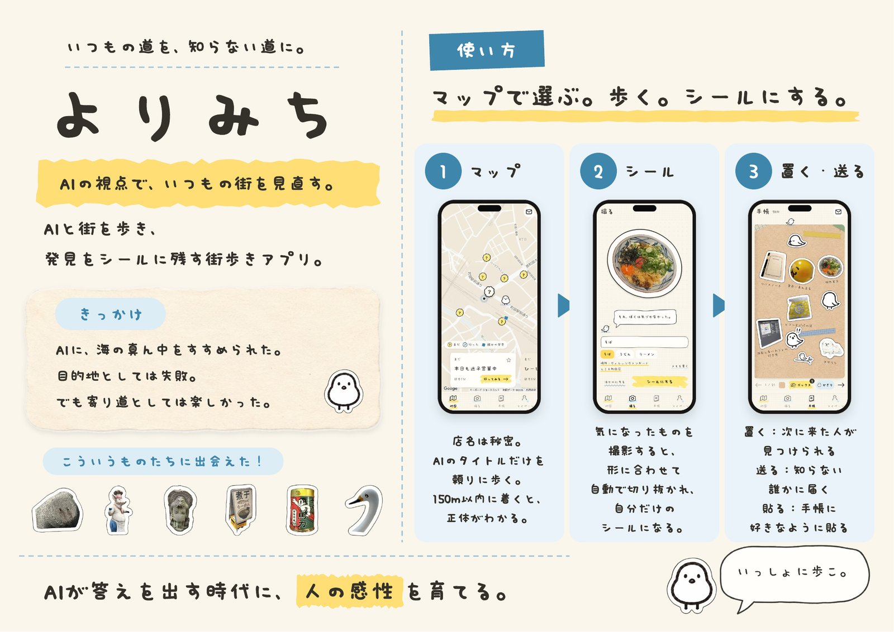
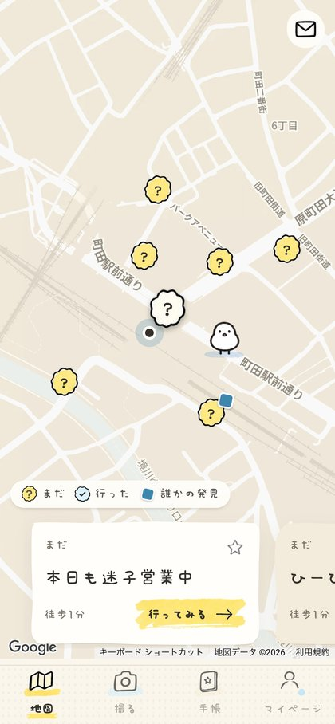
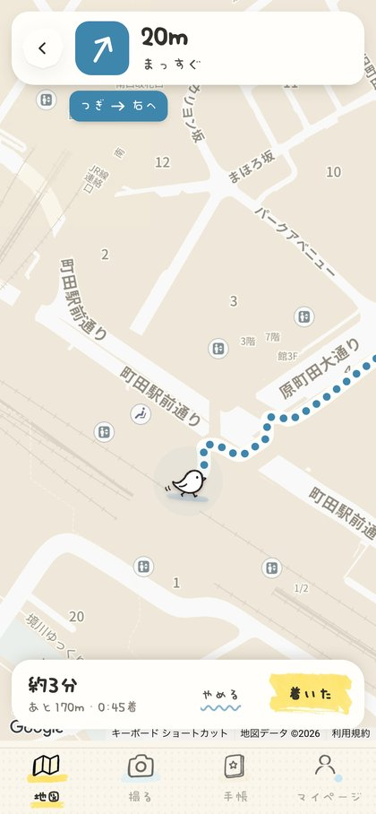
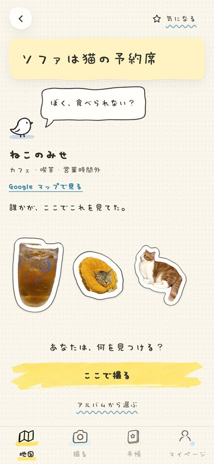
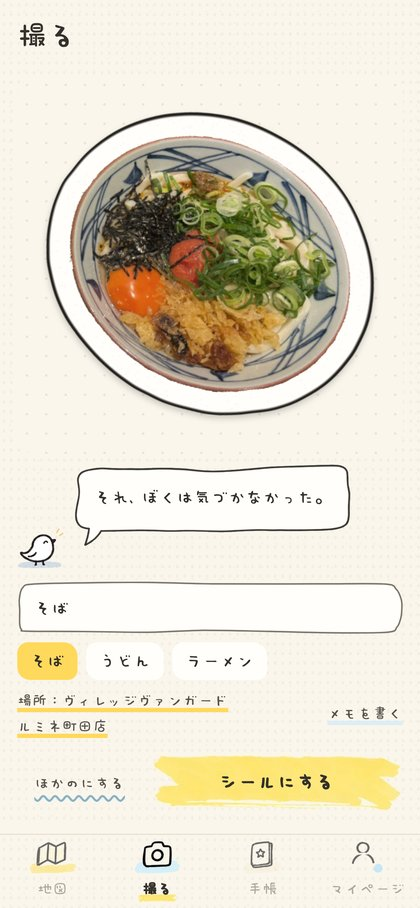
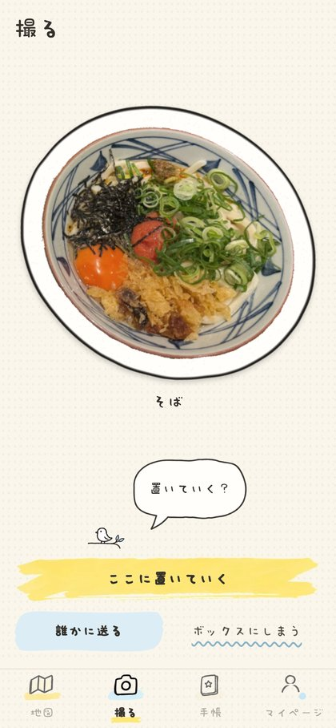
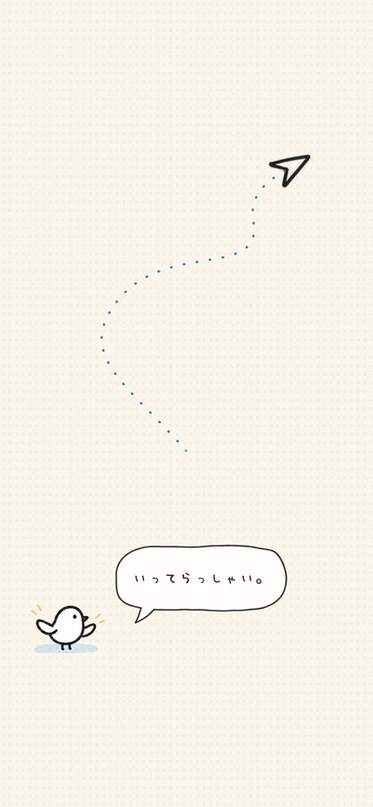
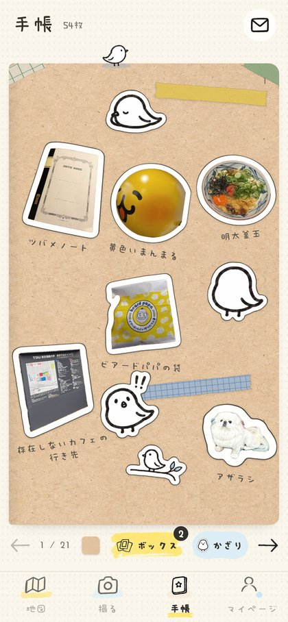
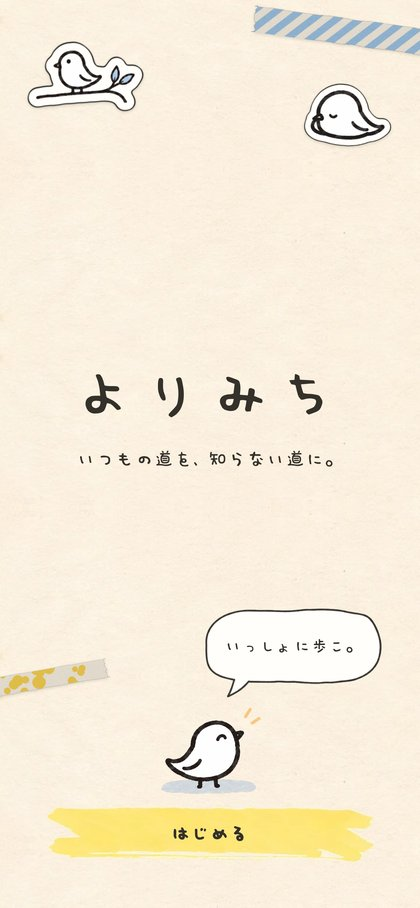

# よりみち / YORIMICHI

**いつもの道を、知らない道に。**
AIと街を歩き、発見をシールに残す街歩きアプリ。



---

## どんなアプリ？

地図アプリは、正しい店名と最短ルートを教えてくれます。
よりみちは逆に、**店名を伏せて、AIがつけた少し変なタイトルだけ**を地図に並べます。

「ソファは猫の予約席」「本日も迷子営業中」——気になったタイトルを頼りに歩き、着いたら正体がわかります。そこで見つけたものを撮ると、形に沿って切り抜かれて**シール**になります。シールはその場に置いたり、知らない誰かに送ったり、自分の手帳に貼ったりできます。

> AIは主人公ではありません。最初のきっかけ（タイトル）を置くだけで、何を見つけるかは歩く人が決めます。

### きっかけ

昔、自作AI旅提案アプリに旅の提案をさせたら、江ノ島で「海の真ん中」をすすめられました。目的地としては失敗。でも、そこまで歩いた寄り道は楽しかった。
AIのずれた視点を「間違い」ではなく「いつもの街を見直すきっかけ」として使えないか、と考えて作りました。

---

## 使い方

| 1. 地図で選ぶ | 2. 歩く | 3. 着いたらわかる | 4. シールにする |
|:---:|:---:|:---:|:---:|
|  |  |  |  |
| 「？」はAIがタイトルをつけた場所。店名は秘密 | アプリ内の地図で徒歩ナビ | 着くと店名がわかり、誰かが置いたシールも見える | 撮った物が形に沿って切り抜かれる。名前は候補から選ぶか自分で入力 |

| 5. 行き先を選ぶ | 6. 知らない誰かに届く | 7. 手帳に貼る | はじめの画面 |
|:---:|:---:|:---:|:---:|
|  |  |  |  |
| ここに置いていく／誰かに送る／ボックスにしまう | 送ると、誰かの発見がひとつ返ってくることも | 集めたシールを好きなように貼る | 案内役の小さな鳥「みちび」 |

---

## こだわったところ

- **答えを先に見せない**：店名・写真・口コミは着くまで伏せます。星評価は出しません。
- **AIのタイトルは場所ごとに1回だけ**：一度作ったタイトルは保存して、みんなで使い回します。
- **写真はなるべく端末の中で処理**：切り抜きと名前の候補は、端末内の小さな画像モデルで行います（iPhoneでは重い処理だけサーバーで分担）。
- **地図アプリではなく、散歩の手帳のように**：手描きの枠や吹き出し、紙やテープの質感、丸い手書きの書体でまとめています。

---

## 使った技術

| 分類 | 技術 |
|---|---|
| アプリ本体 | Next.js 16（App Router）/ React 19 / TypeScript / Tailwind CSS 4。スマホ向けWebアプリ（ホーム画面に追加できる） |
| 地図・場所 | Google Maps JavaScript API、Places API (New)、Routes API、ブラウザの位置情報 |
| AIのタイトル | Claude API（Anthropic SDK、構造化出力） |
| 切り抜き | SlimSAM（Transformers.js、端末内で実行）。読み込めないときは remove.bg、最後は丸い切り取り |
| 名前の候補 | MobileCLIP（端末内）と自作の単語リストを照合。自分がつけた名前も覚えて次から優先 |
| 文字組み | BudouX（日本語を単語の途中で改行しない） |
| 保存 | Supabase（匿名ログイン・DB・Storage）。未設定ならサーバーの `./.data` |
| 入力チェック | Zod |

---

## 動かしてみる

```bash
npm install
cp .env.example .env.local   # キーを入れる（下の表）
npm run dev                  # http://localhost:3000
```

ブラウザで開くと位置情報の許可を求められます（localhost は https でなくても位置情報が使えます）。

### スマホで試す

スマホのブラウザは https でないと位置情報とカメラが使えないので、専用のコマンドがあります。

```bash
npm run dev:phone
```

同じWi-FiのスマホでMacのIPアドレス（例 `https://192.168.x.x:3000`）を開き、証明書の警告を許可してください。

### キーなしで画面だけ見る

`.env.local` に `NEXT_PUBLIC_USE_MOCK_DATA=true` を入れると、**本物の現在地**のまわりにサンプルのスポットを置き、用意した一文でタイトルをつけます（Vercel本番では無視されます）。

### 環境変数

| 変数 | 必須 | 説明 |
| --- | --- | --- |
| `NEXT_PUBLIC_GOOGLE_MAPS_API_KEY` | 地図表示に | ブラウザ用キー（Maps JavaScript API のみ・リファラー制限） |
| `NEXT_PUBLIC_GOOGLE_MAPS_MAP_ID` | 任意 | Advanced Markers 用 Map ID（未設定なら `DEMO_MAP_ID`） |
| `GOOGLE_PLACES_API_KEY` | ✅ | サーバー用キー（Places API (New)）。ブラウザには出ません |
| `ANTHROPIC_API_KEY` | ✅ | Claude API キー |
| `AI_PROVIDER` | 任意 | `anthropic`（既定）/ `mock` / `off` |
| `ANTHROPIC_MODEL` | 任意 | タイトルを作るモデル（既定 `claude-opus-5`） |
| `ANTHROPIC_EFFORT` | 任意 | `low`（既定）/ `medium` / `high` |
| `NEXT_PUBLIC_SUPABASE_URL` / `NEXT_PUBLIC_SUPABASE_ANON_KEY` / `SUPABASE_SERVICE_ROLE_KEY` | 任意 | 3つそろうと Supabase。なければ `./.data` |
| `SUPABASE_STORAGE_BUCKET` | 任意 | 既定 `stickers` |
| `REMOVE_BG_API_KEY` | 任意 | 端末内の切り抜きが使えないときの予備 |
| `NEXT_PUBLIC_USE_MOCK_DATA` | 任意 | 上の「キーなしで画面だけ見る」 |
| `NEXT_PUBLIC_USE_MOCK_LOCATION` | 任意 | **開発用**。`true` かつ `NEXT_PUBLIC_MOCK_LAT` / `NEXT_PUBLIC_MOCK_LNG` があるときだけ固定位置を使う |
| `NEXT_PUBLIC_SERVICE_AREA` | 任意 | `all`（既定）/ `tokyo`（東京外で案内を出す） |
| `YORIMICHI_ACCESS_KEY` | 任意 | 外から開けるようにするときの合言葉。各端末で一度 `/?key=合言葉` を開く |

---

## 開発者向けメモ

<details>
<summary>Google Cloud の設定</summary>

1. プロジェクトを作成し、課金を有効化
2. Maps JavaScript API / Places API (New) / Routes API を有効化
3. キーを2つ作る
   - ブラウザ用：HTTPリファラー制限、API制限＝Maps JavaScript API
   - サーバー用：API制限＝Places API (New)
4. 任意：Map Management で JavaScript 用 Map ID を作り、淡い配色のスタイルを当てる

閉業しているスポット（`businessStatus` が `OPERATIONAL` 以外）は除外します。

</details>

<details>
<summary>Supabase の設定</summary>

1. プロジェクトを作成
2. Authentication → Anonymous sign-ins を ON
3. SQL Editor で `supabase/schema.sql` を実行
   - 置く・送るはユーザーをまたぐため、書き込みはサーバー（APIルート）だけが service role key で行います
   - 本人のシールか・現地にいるか・1日の上限は、サーバー側でチェックします
4. URL・anon key・service role key を `.env.local` へ

</details>

<details>
<summary>送り合うしくみ</summary>

受け取る人は、①送った本人・作った本人ではない ②14日以内に使っている ③そのスポットに行ったことがない ④6時間以内に何も受け取っていない ⑤同じシールを持っていない 人からランダムに選びます。別のエリアの人を優先します。該当者がいなければ保留し、次に誰かが開いたときに届けます。送った人には、誰かが見つけたシールがひとつ返ってきます。1日3枚まで。

</details>

<details>
<summary>フォルダ構成</summary>

```
src/
  app/          画面（地図・スポット・ナビ・撮る・手帳・届いた・マイページ）と API ルート
  components/   手描きのUI部品（sketch/）、地図（map/）、シール表示、みちび
  lib/
    ai/         タイトル生成（anthropic / mock）とプロンプト
    places/     Google Places
    sticker/    切り抜き（cutter）とシールの描画（render）
    vision/     端末内の名前候補（MobileCLIP）
    server/     置く・送る・届くのルール、保存先（local / supabase）
supabase/schema.sql
```

</details>

### いまの制約

- `./.data` への保存はサーバー1台用。複数台で本番運用するなら Supabase が必要
- オフラインではシールを保存できない
- 通知はアプリを開いたときだけ（プッシュ通知なし）
- 位置情報を許可しないと使えない

### フォントについて

アプリの文字は「ころたんPro」（[ことりのことり。](https://cotorifont.net)）を使っています。購入したフォントのためリポジトリには含めていません。ファイルがない環境では Noto Sans JP で表示されます。
